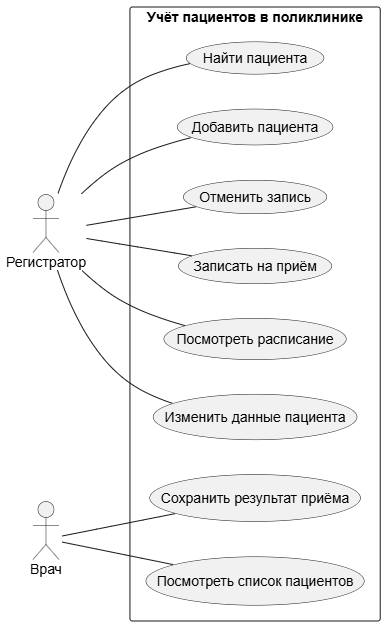
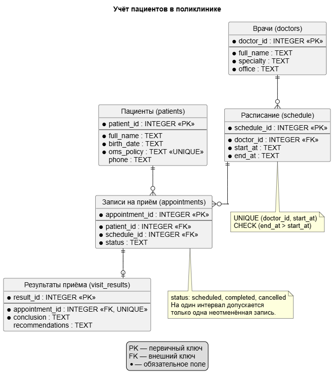

# Учёт пациентов в поликлинике

Учебный проект по теме «Учёт пациентов в поликлинике».

Программа подключается к базе данных SQLite, создаёт таблицы,
загружает тестовые данные и выводит количество записей.
В дальнейшем планируется добавить интерфейс для работы
с пациентами и записями на приём.

## Функции будущей системы

- Регистратор добавляет и ищет пациентов, смотрит расписание и записывает на приём.
- Врач смотрит список пациентов и вносит результат приёма.

| Роль | Задача |
|---|---|
| Регистратор | Работа с пациентами и записями |
| Врач | Просмотр пациентов и результатов приёма |

Перечисленные пользовательские функции пока не реализованы.
На текущем этапе создана база данных и подключена к программе.

## Как запустить

В папке проекта выполните команду `python src/main.py`.

## Диаграмма

[Исходный текст диаграммы PlantUML](docs/use-case.puml)

## Лабораторная работа №3

Подключена база данных SQLite для учёта пациентов в поликлинике.
Программа создаёт таблицы, загружает тестовые данные и выводит
количество записей в каждой таблице.

### ER-диаграмма базы данных

[Исходный код диаграммы](diagrams/er.puml)

### Таблицы базы данных

- patients — пациенты.
- doctors — врачи.
- schedule — интервалы приёма врачей.
- appointments — записи пациентов на приём.
- visit_results — заключения и рекомендации по результатам приёма.

Структура таблиц описана в schema.sql.
Тестовые данные находятся в seed.sql.
Файл poliklinika.db создаётся автоматически при запуске программы.
## Лабораторная работа №4

Проект разделён на слои:

- `src/models` — модели таблиц через `dataclass`;
- `src/repositories` — SQL-запросы и CRUD-операции;
- `src/services` — проверки и бизнес-логика;
- `src/ui` — консольное меню и взаимодействие с пользователем.

Для запуска выполните `python src/main.py`.

Тестовые учётные записи:

- регистратор: `registrar` / `registrar`;
- врач: `doctor` / `doctor`.
